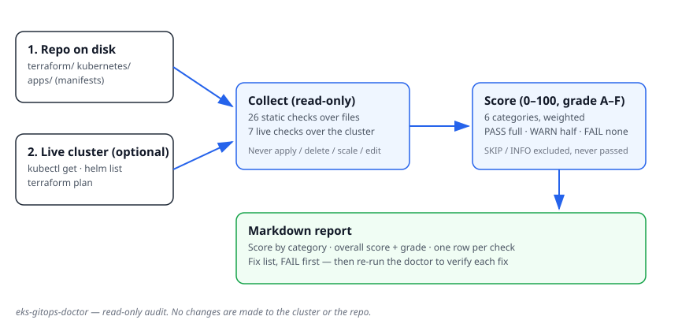

# eks-gitops-doctor 🩺

[](LICENSE)
[](https://github.com/XEESHANAKRAM/eks-gitops-doctor/actions)
[](SKILL.md)

> **An AI agent skill that audits your EKS + ArgoCD GitOps setup end to end and
> hands you a scored report with fixes — without touching anything.**

Point it at a repo, or at a live cluster, and get a 0–100 score across
Cluster, ArgoCD, IAM, Network, Monitoring, and Operations, with every finding
explained and a prioritised fix list. It is **read-only by design**: it runs
`kubectl get`, `helm list`, `terraform plan`, and file reads — never `apply`,
`delete`, `scale`, or `edit`.

## Who it is for

- You run EKS with ArgoCD and want a second opinion before a release, an
  audit, or a handover.
- You inherited a cluster and need to know what is broken, in priority order.
- You built a starter (like the author's
  [eks-gitops-starter](https://github.com/XEESHANAKRAM/eks-gitops-starter))
  and want to prove it is healthy.

## Quickstart

```bash
git clone https://github.com/XEESHANAKRAM/eks-gitops-doctor.git
cd eks-gitops-doctor

# Audit a repo's Terraform + manifests (no cluster needed)
./scripts/doctor.sh --static /path/to/your-eks-repo

# Audit the live cluster kubectl points at
./scripts/doctor.sh --live

# Both, and save the report
./scripts/doctor.sh --static /path/to/your-eks-repo --live --output report.md
```

Requirements: `bash` 4+, `grep`, `awk`. For `--live` you also need `kubectl`
(and `helm` for the Helm release check). No other dependencies.

## How it works



1. **Collect** — static checks read your Terraform and Kubernetes manifests;
   live checks run `kubectl get` and `helm list` against the cluster.
2. **Score** — 33 checks in 6 weighted categories. `PASS` is full credit,
   `WARN` is half, `FAIL` is none. Checks that could not run are `SKIP`ped
   and excluded from scoring, never silently passed.
3. **Report** — a Markdown report: score by category, overall score and
   grade (A–F), one row per check, and a fix list ordered FAIL first.

Full method: [`docs/usage.md`](docs/usage.md). Every check explained:
[`docs/checks.md`](docs/checks.md).

## Example output

A real run against the author's own
[eks-gitops-starter](https://github.com/XEESHANAKRAM/eks-gitops-starter)
repo — 82/100, Grade B:

```
Overall: 82/100 — Grade B
16 passed, 9 warnings, 0 failures, 1 notes, 7 skipped.
```

Top findings: Kubernetes 1.31 is past standard support, the public API
endpoint defaults to `0.0.0.0/0`, no PodDisruptionBudget, single NAT gateway,
and Alertmanager has no receiver configured — alerts fire and go nowhere.
The full report is in [`examples/sample-report.md`](examples/sample-report.md),
walked through finding by finding in
[`docs/sample-report.md`](docs/sample-report.md).

## What it checks

| Category | Weight | Examples |
| -------- | ------ | -------- |
| Cluster | 20% | Node groups, EKS add-ons, Kubernetes version, control-plane logging, public endpoint |
| ArgoCD | 25% | Sync + health, drift, ApplicationSets, auto-sync with prune + self-heal, HA |
| IAM | 15% | IRSA enabled, roles scoped to one service account, CI role read-only |
| Network | 15% | Private subnets, VPC flow logs, NAT per AZ, ELB subnet tags |
| Monitoring | 15% | Prometheus retention + storage, Grafana, alert rules, Alertmanager receivers |
| Operations | 10% | Terraform remote state, Ingress controller, resource requests/limits |

## As an agent skill

This repo follows the open
[Agent Skills](https://agentskills.io) format. Drop it into an agent that
supports skills (Claude Code, Codex, Cursor) and ask the agent to audit a
cluster — [`SKILL.md`](SKILL.md) tells it the rules, the checks, and the
scoring rubric. The agent runs the scripts; it never improvises checks.

## Docs

| Guide | What it covers |
| ----- | -------------- |
| [`docs/installation.md`](docs/installation.md) | Install + requirements |
| [`docs/usage.md`](docs/usage.md) | Run modes, options, exit codes, CI use |
| [`docs/run-guide.md`](docs/run-guide.md) | Step-by-step run with expected output |
| [`docs/checks.md`](docs/checks.md) | Every check: what, why, how to fix |
| [`docs/sample-report.md`](docs/sample-report.md) | Walkthrough of the real sample report |
| [`docs/troubleshooting.md`](docs/troubleshooting.md) | Common problems |
| [`docs/faq.md`](docs/faq.md) | Questions, answered |
| [`docs/security.md`](docs/security.md) | Read-only guarantee, no secrets collected |

## Status

This skill is new — it was built in November 2026 and dogfooded against the
author's own eks-gitops-starter repo. There are no users, stars, or download
counts to quote yet, and none are claimed here. If it helped you, a star and
an issue describing your setup would help it improve.

## Contributing

See [`CONTRIBUTING.md`](CONTRIBUTING.md). Bug reports with the report output
attached are the most useful kind.

## License

MIT — see [`LICENSE`](LICENSE).
